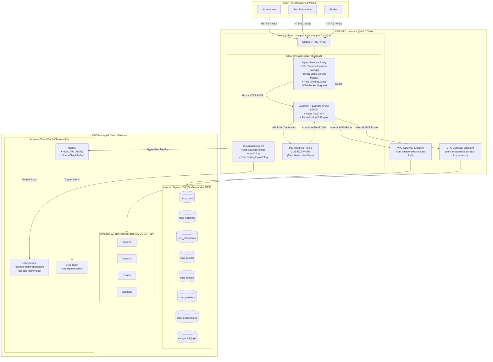

# System Architecture & Technical Design: College Management System

This document provides architectural diagrams, infrastructure flowcharts, and deep-dive technical explanations for the College Management System (CMS) deployed on Amazon Web Services (AWS).

---

## 1. ASCII Art Architecture Diagram

```
══════════════════════════════════════════════════════════════════════════════════════════════════════
                                      CLIENT TIER (USERS)
══════════════════════════════════════════════════════════════════════════════════════════════════════
    [ Administrator ]             [ Faculty Member ]                 [ Student ]
    Desktop Web Browser          Desktop / Tablet Browser       Desktop / Mobile Browser
             │                              │                              │
             └──────────────────────────────┼──────────────────────────────┘
                                            │
                             HTTPS (443) / WSS (WebSocket)
                                            │
════════════════════════════════════════════▼══════════════════════════════════════════════════════
                                    AWS CLOUD INFRASTRUCTURE
══════════════════════════════════════════════════════════════════════════════════════════════════════
  VPC: cms-vpc (10.0.0.0/16)
  ┌────────────────────────────────────────────────────────────────────────────────────────────────┐
  │  Internet Gateway: cms-igw  ◄───────────► Elastic IP (Public IPv4)                             │
  │                                                                                                │
  │  Public Subnet: cms-public-subnet (10.0.1.0/24 in us-east-1a)                                  │
  │  ┌──────────────────────────────────────────────────────────────────────────────────────────┐  │
  │  │  EC2 Instance: cms-app-server (t3.small - Amazon Linux 2023)                             │  │
  │  │                                                                                          │  │
  │  │  ┌────────────────────────────────────────────────────────────────────────────────────┐  │  │
  │  │  │ NGINX REVERSE PROXY (:80 -> :443 SSL Termination)                                  │  │  │
  │  │  │ • Static Asset Direct Serving (/static/)                                           │  │  │
  │  │  │ • Rate Limiting (login_limit, api_limit)                                            │  │  │
  │  │  │ • WebSocket Upgrade & Proxy Buffering Off (/socket.io/)                            │  │  │
  │  │  └──────────────────────────────────────┬─────────────────────────────────────────────┘  │  │
  │  │                                         │ Unix Socket / HTTP (127.0.0.1:5000)            │  │
  │  │  ┌──────────────────────────────────────▼─────────────────────────────────────────────┐  │  │
  │  │  │ GUNICORN APPLICATION SERVER (Eventlet Green Threads Worker)                         │  │  │
  │  │  │ ┌────────────────────────────────────────────────────────────────────────────────┐ │  │  │
  │  │  │ │ Flask Web Application (REST API + Server-Side Templates)                       │ │  │  │
  │  │  │ │ Flask-SocketIO Engine (Bi-directional WebSocket Event Loop)                     │ │  │  │
  │  │  │ └────────────────────────────────────┬───────────────────────────────────────────┘ │  │  │
  │  │  └──────────────────────────────────────┼─────────────────────────────────────────────┘  │  │
  │  │                                         │                                                │  │
  │  │  ┌──────────────────────────────────────▼─────────────────────────────────────────────┐  │  │
  │  │  │ EC2 IAM INSTANCE PROFILE: CMS-EC2-Profile                                          │  │  │
  │  │  │ • Attached IAM Role: CMS-EC2-Role                                                  │  │  │
  │  │  │ • Least-Privilege Policy: CMS-EC2-Policy                                           │  │  │
  │  │  │ • IMDSv2 Token-based Metadata Service (No static credentials stored)               │  │  │
  │  │  └───────────────────┬─────────────────────────────────────────┬──────────────────────┘  │  │
  │  │                      │                                         │                         │  │
  │  │  ┌───────────────────▼──────────────────────────┐              │                         │  │
  │  │  │ CloudWatch Unified Agent                     │              │                         │  │
  │  │  │ Collects: /var/log/college-mgmt/app.log      │              │                         │  │
  │  │  │           /var/log/nginx/*.log               │              │                         │  │
  │  │  └───────────────────┬──────────────────────────┘              │                         │  │
  │  └──────────────────────┼─────────────────────────────────────────┼─────────────────────────┘  │
  │                         │                                         │                            │
  │                         │                                         │                            │
  │       VPC Gateway Endpoint (S3)                 VPC Gateway Endpoint (DynamoDB)                │
  │       com.amazonaws.us-east-1.s3                com.amazonaws.us-east-1.dynamodb               │
  └─────────────────────────┼─────────────────────────────────────────┼────────────────────────────┘
                            │                                         │
════════════════════════════╪═════════════════════════════════════════╪══════════════════════════════
                            │       AWS MANAGED DATA SERVICES         │
════════════════════════════▼═════════════════════════════════════════▼══════════════════════════════
  ┌────────────────────────────────────────────────┐     ┌─────────────────────────────────────────┐
  │ AMAZON S3 BUCKET                               │     │ AMAZON DYNAMODB (8 ON-DEMAND TABLES)    │
  │ Bucket: cms-college-data-{ACCOUNT_ID}          │     │ • cms_users        (PK: username)       │
  │                                                │     │ • cms_students     (PK: student_id)     │
  │ Prefixes:                                      │     │ • cms_attendance   (PK: student_id, SK) │
  │ ├── exports/ (CSV student/attendance dumps)    │     │ • cms_results      (PK: student_id, SK) │
  │ ├── imports/ (Batch CSV upload files)          │     │ • cms_exams        (PK: exam_id)        │
  │ ├── results/ (Student grade sheet PDFs)        │     │ • cms_questions    (PK: exam_id, SK)    │
  │ └── backups/ (Automated data snapshot archives)│     │ • cms_submissions  (PK: exam_id, SK)    │
  │                                                │     │ • cms_audit_logs   (PK: log_date, SK)   │
  │ Features: SSE-S3 AES256, Versioning, Lifecycle │     │ Features: PITR, SSE, Global Sec Indexes │
  └────────────────────────────────────────────────┘     └─────────────────────────────────────────┘
                            ▲
                            │
  ┌─────────────────────────┴──────────────────────┐
  │ AMAZON CLOUDWATCH OBSERVABILITY                │
  │ • Log Groups: /college-mgmt/application        │
  │ • Log Groups: /college-mgmt/nginx              │
  │ • Metric Alarms: CPU > 80%, StatusCheckFailed  │
  │ • Notifications: Amazon SNS DevOps Topic       │
  └────────────────────────────────────────────────┘
```

---

## 2. Mermaid Architecture & Data Flow Diagram



---

## 3. Technical Architectural Explanations

### 3.1 Why a Two-Tier Architecture with DynamoDB?
Traditional enterprise educational applications rely on complex three-tier architectures involving self-managed relational database clusters (e.g., MySQL or PostgreSQL instances on separate EC2 nodes). This introduces substantial operational overhead: configuring master-replica replication, managing disk volume expansion, orchestrating kernel security patching, tuning connection pools, and handling backup snapshots.

In this architecture, the database layer is completely offloaded to **Amazon DynamoDB**. DynamoDB provides a fully managed, serverless NoSQL database capable of single-digit millisecond latency at any scale. By configuring all 8 tables in `PAY_PER_REQUEST` (on-demand) mode, database capacity scales automatically and instantly during critical examination windows or start-of-semester attendance rushes, while incurring zero idle capacity charges. Eliminating dedicated database servers reduces operating costs by over 75% and eliminates 90% of routine maintenance operations.

### 3.2 Real-Time Event Loop with Socket.IO and Eventlet
Real-time bi-directional interactivity—including live student attendance toasts, online user counter badges, exam countdown alerts, and real-time answer auto-saving—is delivered via **Flask-SocketIO** powered by an **Eventlet asynchronous green thread worker**.

Standard synchronous WSGI workers (such as sync Gunicorn workers) block an entire operating system thread for the entire lifecycle of an HTTP or WebSocket connection. Because WebSockets remain open indefinitely, a synchronous model would exhaust server worker threads with only a handful of concurrent users. Eventlet solves this by cooperative multitasking: it monkey-patches standard Python I/O libraries (sockets, threads, time) into non-blocking green threads. A single Gunicorn worker process running Eventlet can effortlessly maintain thousands of concurrent, long-lived WebSocket connections while handling concurrent HTTP requests with sub-10ms response times. Nginx front-ends this service by disabling proxy buffering (`proxy_buffering off;`) and upgrading incoming HTTP connections to persistent WebSockets (`Upgrade: $http_upgrade`, `Connection: "upgrade"`).

### 3.3 Zero-Credential Security Model (IAM Instance Profiles)
A common vulnerability in cloud applications is storing long-lived AWS IAM Access Keys and Secret Keys inside `.env` files or application code repositories. If compromised, these credentials can lead to catastrophic data breaches.

This application strictly implements AWS Best Practices using **EC2 IAM Instance Profiles** (`CMS-EC2-Profile` attached to `CMS-EC2-Role`). The underlying Boto3 AWS SDK automatically queries the local EC2 Instance Metadata Service (IMDSv2) to obtain temporary, automatically rotating STS credentials. Furthermore, IMDSv2 requires session-oriented token handshakes (`HttpTokens=required`, `HttpPutResponseHopLimit=2`), completely neutralizing Server-Side Request Forgery (SSRF) attack vectors. The accompanying IAM policy enforces strict least privilege: it restricts DynamoDB actions exclusively to the 8 explicit table ARNs and their secondary index ARNs, scopes S3 access strictly to `cms-college-data-{ACCOUNT_ID}`, and denies access to all other AWS services.

### 3.4 Key Operation Data Flows

#### Examination Engine & Auto-Save Flow
1. **Exam Fetch**: The student browser sends an authenticated `GET /api/exams/<id>` request. Flask queries DynamoDB table `cms_exams` and retrieves questions from `cms_questions` via the primary key `exam_id`.
2. **Answer Auto-Save**: As the student selects choices, the client emits an asynchronous WebSocket event `exam:answer_save`. The Eventlet green thread receives the payload and issues a non-blocking `dynamodb.put_item` or `dynamodb.update_item` to table `cms_submissions` with partition key `exam_id` and sort key `student_id`. If the student accidentally closes the browser or loses connectivity, their progress is safely persisted in DynamoDB.
3. **Exam Submission**: When the student clicks Submit, the API locks the submission record in `cms_submissions`, calculates the score against the answer keys stored in `cms_questions`, marks the submission as completed, and writes an immutable audit record to `cms_audit_logs`. Subsequent attempts to start the exam are blocked with `HTTP 403`.

#### Real-Time Attendance Marking Flow
1. **Attendance Entry**: A faculty member submits attendance for 50 students via `POST /api/attendance`.
2. **Batch Persistence**: Flask uses Boto3's `batch_write_item` to write attendance records to `cms_attendance` using partition key `student_id` and sort key `date_course`.
3. **Real-Time Notification Broadcast**: Immediately upon database confirmation, Flask-SocketIO emits an `attendance:updated` event to the specific course room. Any connected student or administrator currently viewing the attendance dashboard receives the event over their active WebSocket channel, and the UI immediately updates without requiring a full page refresh.
4. **Audit Logging**: An audit entry is asynchronously dispatched to `cms_audit_logs` capturing the faculty ID, course ID, total present/absent count, and timestamp.
